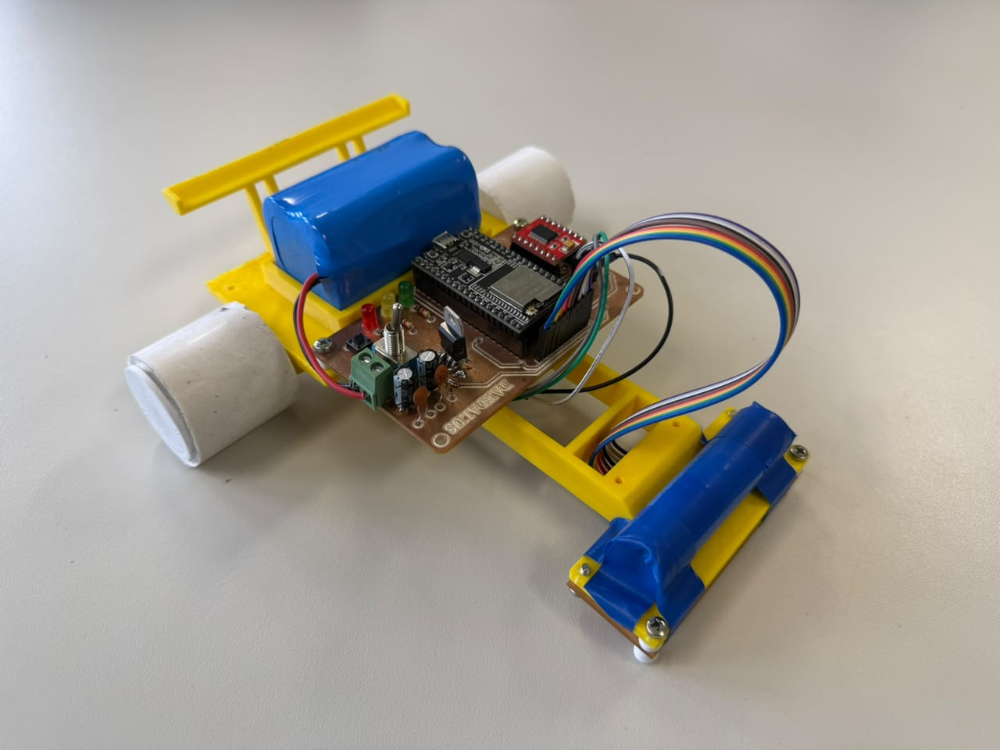
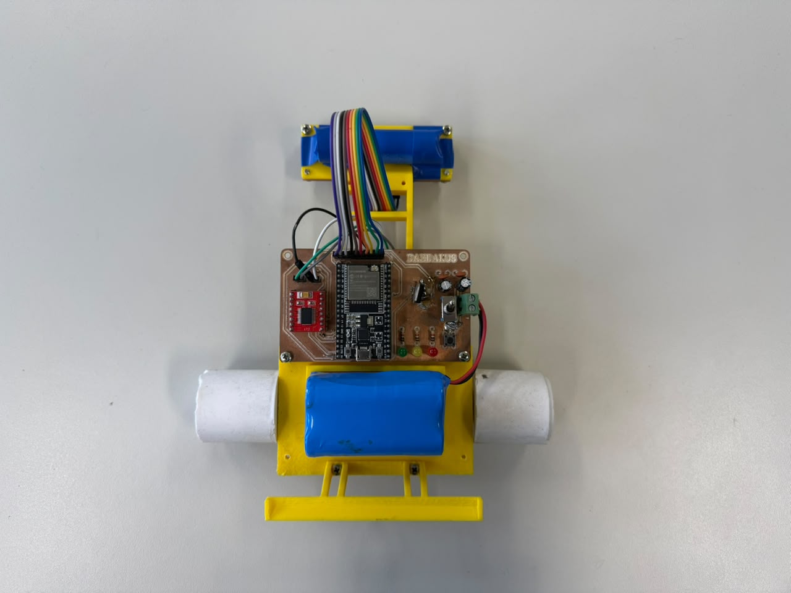
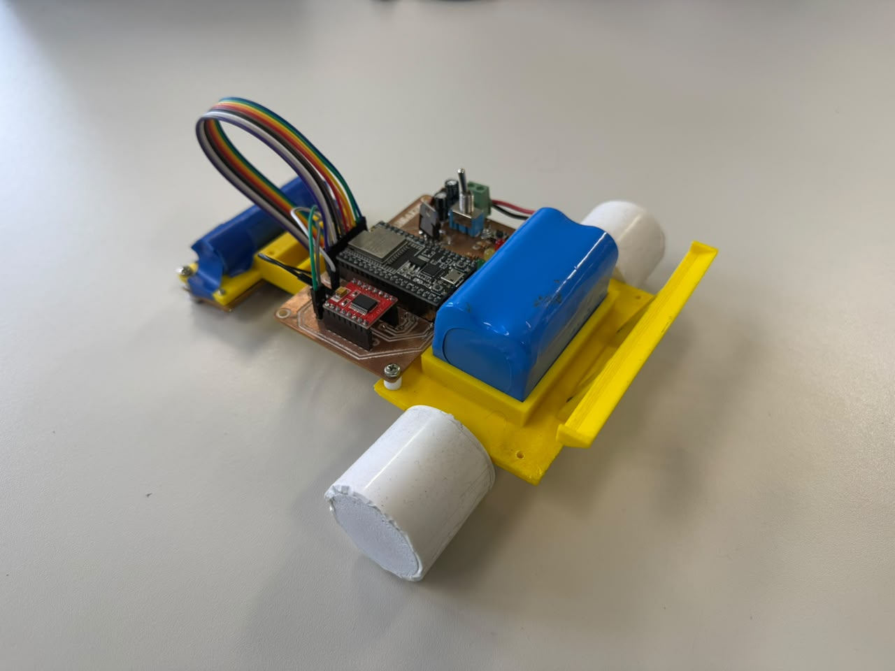
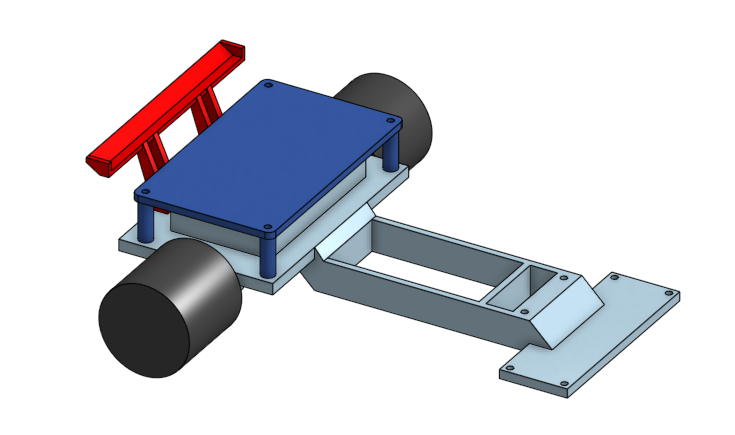
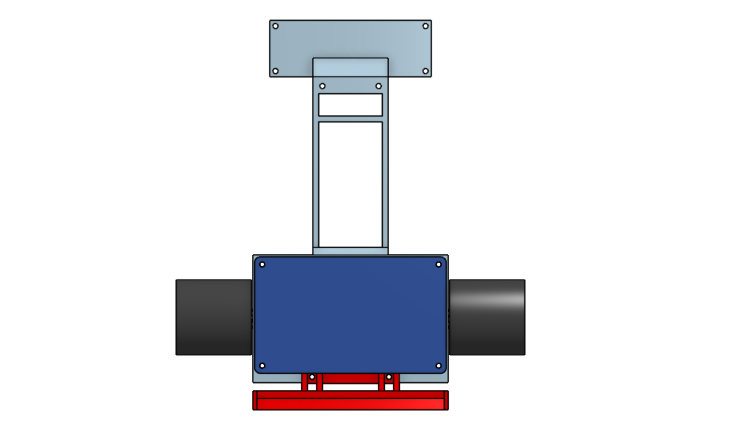
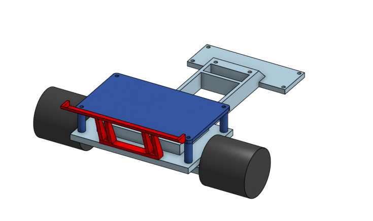

# Daedalus

<div align="center">

[](./README-pt-br.md)
[](./README.md)

**Robô seguidor de linha com sete sensores infravermelhos e ESP-WROOM-32U.**

</div>

O Daedalus é um robô autônomo que detecta e segue uma linha usando um conjunto de sete sensores infravermelhos. O firmware controla os motores com um PID e permite calibrar os sensores usando o botão e os LEDs da placa.

## Conteúdo

- [`3d/`](./3d/): modelos CAD do chassi, suporte da PCB e asa traseira, em formato STEP.
- [`pcbs/`](./pcbs/): imagens do projeto eletrônico e arquivos Gerber para fabricação da placa.
- [`docs/imgs/`](./docs/imgs/): fotografias do robô e visualizações dos modelos 3D.
- [`code/`](./code/): sketch Arduino, módulos do firmware e Makefile.

## Modelos 3D

Os arquivos STEP podem ser abertos em um programa CAD compatível:

- [Chassi](./3d/chassi.step)
- [Suporte da PCB](./3d/pcb_support.step)
- [Asa traseira](./3d/rear_wing.step)

## PCB

O diretório [`pcbs/`](./pcbs/) contém as imagens do projeto e os arquivos de fabricação Gerber, incluindo camadas de cobre, contorno da placa e furação.

- [Projeto da PCB](./pcbs/pcb_design.png)
- [Esquemático](./pcbs/schematic.png)
- [Arquivos Gerber](./pcbs/Gerber/)

## Imagens

### Robô montado

| Vista frontal | Vista superior | Vista traseira |
| --- | --- | --- |
|  |  |  |

### Modelos 3D

| Vista frontal | Vista superior | Vista traseira |
| --- | --- | --- |
|  |  |  |

## Código

O firmware está em [`code/`](./code/) e foi preparado para uma placa ESP32 usando Arduino. O `Makefile` utiliza o Arduino CLI e a definição de placa `esp32:esp32:esp32`.

### Principais arquivos

- [`code.ino`](./code/code.ino): inicialização, estados do robô, calibração e lógica de seguimento.
- [`config.h`](./code/config.h) e [`config.cpp`](./code/config.cpp): configuração e instâncias dos sensores, motores, LEDs e PID.
- [`pins.h`](./code/pins.h): associação dos sinais aos pinos do ESP32.
- [`calibration.cpp`](./code/calibration.cpp): calibração e gravação dos valores na memória Preferences do ESP32.
- [`modules/`](./code/modules/): implementação dos sensores IR, motores, LEDs e controlador PID.
- [`Makefile`](./code/Makefile): atalhos para compilar, carregar o firmware e abrir o monitor serial.

### Preparar e carregar

Instale o Arduino CLI e o suporte de placas ESP32. No terminal, entre em `daedalus/code/` e use:

```sh
make ports
make compile
make upload PORT=/dev/ttyUSB0
make monitor PORT=/dev/ttyUSB0
```

Substitua `/dev/ttyUSB0` pela porta serial da sua placa. Para compilar e carregar em sequência, use `make flash PORT=/dev/ttyUSB0`. A velocidade do monitor serial é 115200 baud.

## Operação

1. Ao ligar, o robô fica parado aguardando o botão.
2. Para calibrar, pressione e solte o botão antes de completar três segundos. Siga a indicação dos LEDs: coloque os sensores sobre a superfície preta e pressione o botão; depois coloque-os sobre a superfície branca e pressione novamente. Os valores são salvos no ESP32 e o robô reinicia.
3. Para iniciar o seguidor de linha, mantenha o botão pressionado por pelo menos três segundos e solte-o.
4. Durante o seguimento, pressione o botão para parar e voltar ao estado de espera.

O controlador usa sete leituras normalizadas e PID para ajustar os motores. Se a linha deixar de ser detectada, o robô aguarda uma breve confirmação e tenta procurá-la na última direção conhecida.

## Pinos

| Função | Pinos do ESP32 |
| --- | --- |
| Sensores IR, da esquerda para a direita | 36, 39, 34, 4, 35, 32, 33 |
| LED dos sensores IR | 14 |
| Motor A (direito): PWM, IN1, IN2 | 25, 26, 27 |
| Motor B (esquerdo): PWM, IN1, IN2 | 13, 21, 22 |
| Botão | 19 |
| LEDs verde, amarelo e vermelho | 18, 5, 17 |

Os parâmetros de PID, velocidade e busca da linha estão definidos em [`code/calibration.h`](./code/calibration.h).
