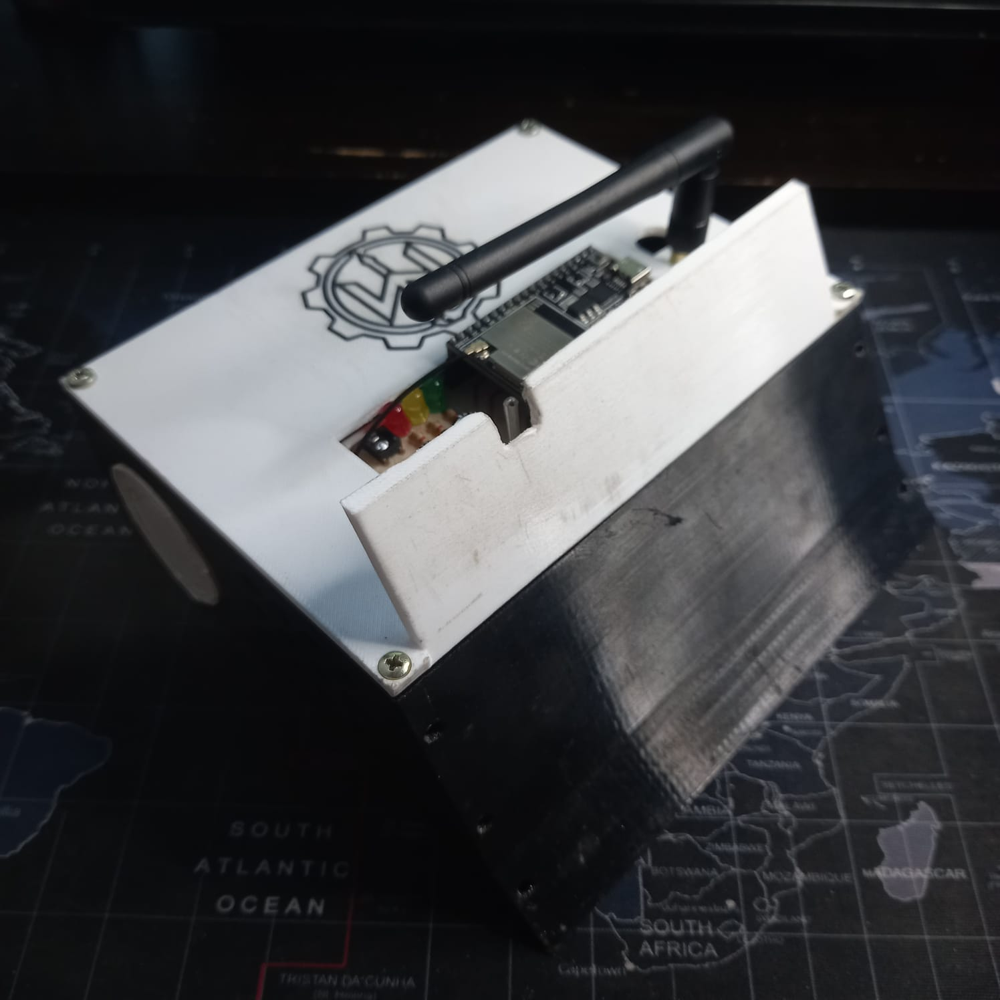
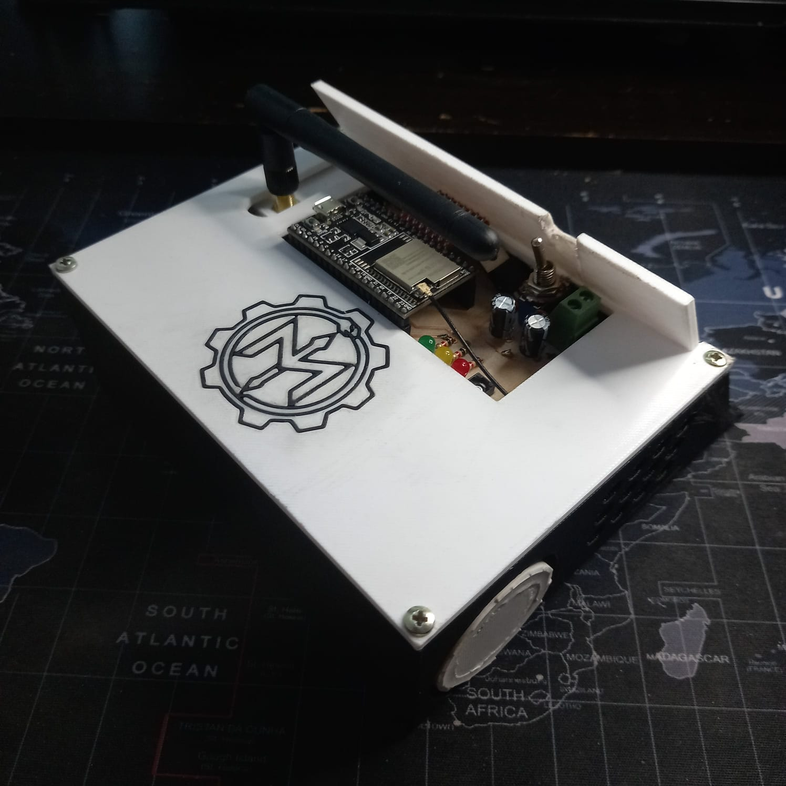
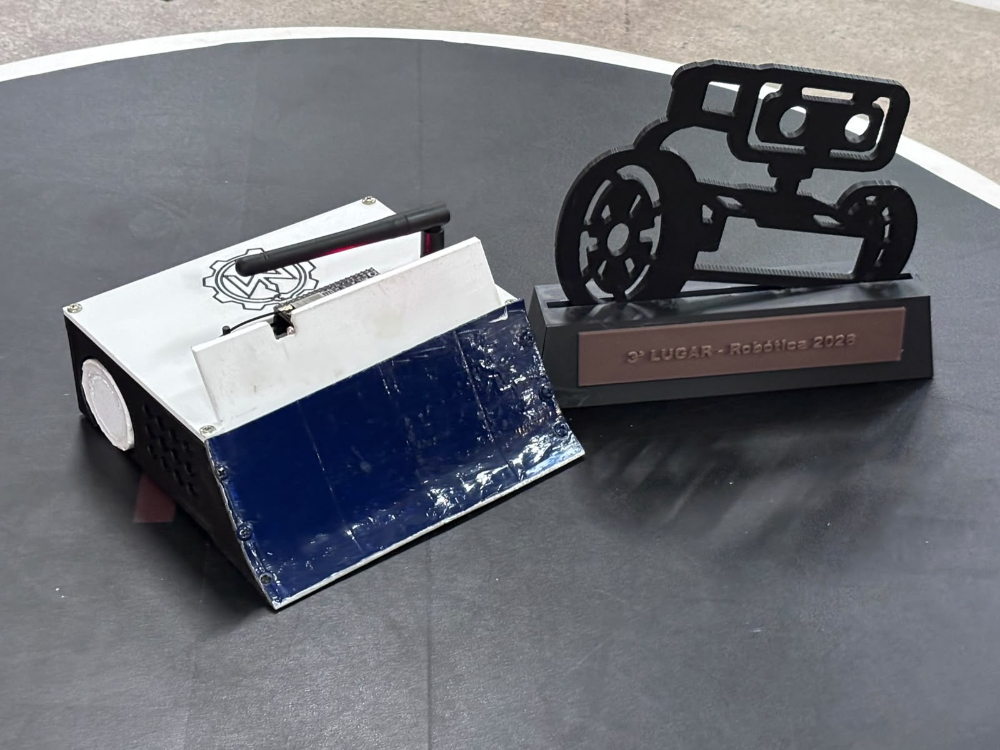
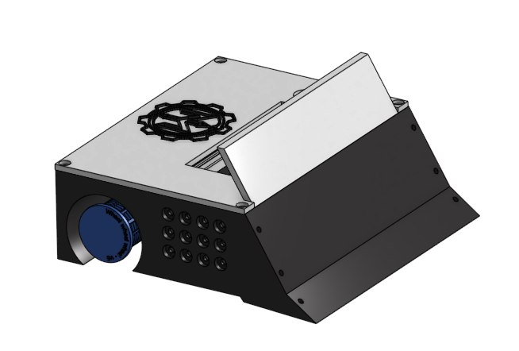
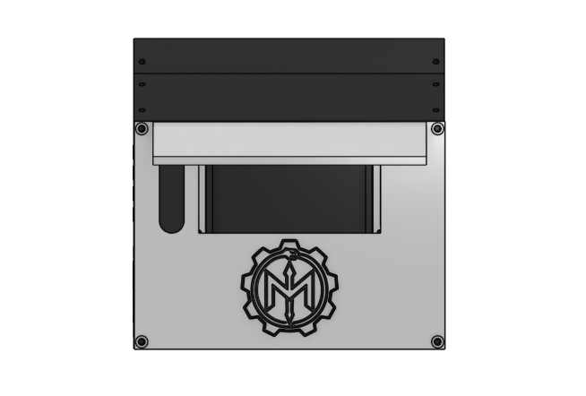
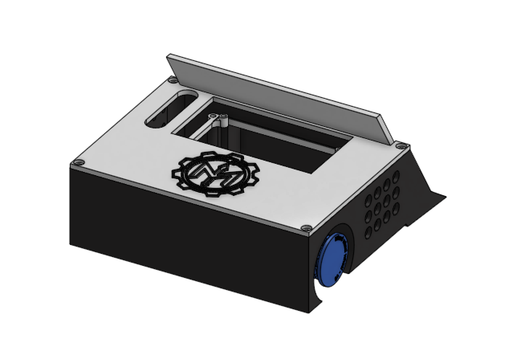

# Hórus

<div align="center">

[](./README-pt-br.md)
[](./README.md)

**Robô de mini-sumô de 15 x 15 cm controlado por um controle de PlayStation 4 via BLE.**

</div>

O Hórus é um robô de mini-sumô controlado remotamente e construído em torno de um ESP-WROOM-32U. Uma interface web lê os comandos de um controle de PlayStation 4 e os envia ao robô por Bluetooth Low Energy (BLE). A categoria limita as dimensões a 150 x 150 mm e a massa a 1.000 g.

## Conteúdo

- [`3d/`](./3d/): modelos STEP do chassi, da tampa, da base da PCB e do suporte da antena.
- [`pcbs/`](./pcbs/): imagens do projeto e do esquemático da PCB, além dos arquivos Gerber para fabricação.
- [`docs/imgs/`](./docs/imgs/): fotografias do robô montado e vistas do modelo 3D.
- [`code/`](./code/): firmware Arduino, módulos e Makefile.
- [`../global/3d/`](../global/3d/): modelos compartilhados das rodas e da logo.

## Modelos 3D

Abra os arquivos STEP em um programa CAD compatível:

- [Chassi](./3d/chassi.step)
- [Tampa](./3d/cover.step)
- [Base da PCB](./3d/pcb_base.step)
- [Suporte da antena](./3d/antenna_support.step)

O Hórus utiliza a [roda v5](../global/3d/wheel_v5.step).

### Parâmetros de impressão 3D

Preencha o material e os parâmetros de impressão recomendados para cada componente:

| Componente | Filamento | Paredes | Preenchimento |
| --- | --- | --- | --- |
| [Chassi](./3d/chassi.step) | PETG | 2 | 20% |
| [Tampa](./3d/cover.step) | PETG/PLA | 2 | 15% |
| [Base da PCB](./3d/pcb_base.step) | PETG/PLA | 2 | 15% |
| [Suporte da antena](./3d/antenna_support.step) | PETG/PLA | 2 | 15% |
| [Suporte dos motores](../global/3d/bracket.stl) | PETG | 3 | 20% |
| [Logo](../global/3d/mythos_logo.step) | PETG/PLA | 2 | - |
| [Roda v5](../global/3d/wheel_v5.step) | PETG | 5 | 25% |

## PCB

A eletrônica está reunida em uma PCB de dupla face, com 80 x 50 mm, projetada no EasyEDA. A placa integra o ESP-WROOM-32U, a ponte H dupla TB6612FNG, o regulador LM7805CV de 5 V, LEDs de estado, chave liga/desliga, carregador para bateria 2S e conectores da bateria e dos motores.

- [Projeto da PCB](./pcbs/pcb_design.png)
- [Esquemático](./pcbs/schematic.png)
- [Arquivos Gerber](./pcbs/Gerber/)

O robô é alimentado por uma bateria 18650 2S2P. A linha regulada de 5 V alimenta a lógica, enquanto os motores são ligados diretamente à bateria. O firmware limita a saída normal dos motores a 75%; o modo turbo eleva temporariamente esse limite a 100%.

## Imagens

### Robô montado

| Vista frontal | Vista traseira | Competição |
| --- | --- | --- |
|  |  |  |

### Modelo 3D

| Vista frontal | Vista superior | Vista traseira |
| --- | --- | --- |
|  |  |  |

## Firmware

O firmware foi escrito em C++ para o core Arduino do ESP32. O Makefile utiliza o Arduino CLI e a definição de placa `esp32:esp32:esp32`. O firmware oferece suporte às APIs de PWM das versões 2 e 3 do core Arduino-ESP32.

### Principais arquivos

- [`code.ino`](./code/code.ino): inicializa os módulos e executa as atualizações de BLE, ações e LEDs.
- [`config.h`](./code/config.h) e [`config.cpp`](./code/config.cpp): declarações e instâncias compartilhadas dos motores, LEDs, ações e BLE.
- [`pins.h`](./code/pins.h): atribuição dos pinos GPIO do ESP32.
- [`calibration.h`](./code/calibration.h): sentido dos motores, PWM, limites de velocidade, nome e potência BLE, zona morta dos joysticks e tempo do watchdog.
- [`protocol.h`](./code/protocol.h): identificadores do serviço BLE e definição dos pacotes de comando.
- [`modules/ble.h`](./code/modules/ble.h): servidor BLE, eventos de conexão e validação dos pacotes.
- [`modules/actions.h`](./code/modules/actions.h): interpretação dos joysticks e botões e mistura dos comandos para tração diferencial.
- [`modules/motors.h`](./code/modules/motors.h): sentido e saída PWM para a ponte H TB6612FNG.
- [`modules/leds.h`](./code/modules/leds.h): padrões dos LEDs de estado.
- [`Makefile`](./code/Makefile): comandos para compilar, carregar o firmware, abrir o monitor serial e limpar arquivos de compilação.

### Preparar e carregar

Instale o Arduino CLI e o suporte de placas ESP32. No terminal, entre em `horus/code/` e use:

```sh
make ports
make compile
make upload PORT=/dev/ttyUSB0
make monitor PORT=/dev/ttyUSB0
```

Substitua `/dev/ttyUSB0` pela porta serial da placa. Para compilar e carregar em sequência, use `make flash PORT=/dev/ttyUSB0`. A velocidade do monitor serial é 115200 baud.

## Controle e comunicação

O ESP32 anuncia-se como `Mythos: HORUS` e atua como servidor BLE com uma característica gravável. A interface web complementar do controle é mantida separadamente e não está incluída neste diretório. Quando o controle se desconecta, o firmware para os motores e retoma o anúncio BLE.

Cada pacote de comando possui 7 bytes. Pacotes com tamanho, byte de sincronismo ou checksum incorretos são descartados.

| Byte | Conteúdo |
| --- | --- |
| 0 | Byte de sincronismo (`0xA5`) |
| 1 | Eixo X do joystick esquerdo (não utilizado) |
| 2 | Eixo Y do joystick esquerdo (frente/ré) |
| 3 | Eixo X do joystick direito (rotação) |
| 4 | Eixo Y do joystick direito (não utilizado) |
| 5 | Máscara de bits dos botões |
| 6 | Checksum: soma dos bytes 1 a 5 módulo 256 |

Os eixos usam deslocamento de 100 e são interpretados na faixa de -100 a +100. Uma zona morta de 8 é aplicada ao redor do centro. O eixo vertical do joystick esquerdo controla o avanço e a ré; o eixo horizontal do joystick direito controla a rotação.

| Controle | Ação |
| --- | --- |
| R1 | Turbo enquanto pressionado; eleva o limite dos motores a 100% |
| L1 | Mantém o robô parado enquanto pressionado |
| R2 | Gira à direita com comando máximo enquanto pressionado |
| L2 | Gira à esquerda com comando máximo enquanto pressionado |
| A | Teste de conexão; acende o LED verde enquanto pressionado |

O firmware mistura os comandos de avanço e rotação para a tração diferencial e reduz proporcionalmente as duas saídas se alguma ultrapassar a faixa permitida. Se nenhum comando válido chegar por mais de 300 ms, o watchdog para os motores.

## Pinos e estado

| Função | Pinos do ESP32 |
| --- | --- |
| Motor A: PWM, IN1, IN2 | 32, 25, 33 |
| Motor B: PWM, IN1, IN2 | 14, 26, 27 |
| LEDs verde, amarelo e vermelho | 18, 5, 17 |

O PWM dos motores usa resolução de 8 bits e frequência de 7 kHz. O sentido dos motores pode ser invertido em [`code/calibration.h`](./code/calibration.h), sem alterar a fiação.

| Estado do robô | Indicação dos LEDs |
| --- | --- |
| Inicialização | Vermelho fixo |
| Aguardando conexão | Amarelo piscando a cada 400 ms |
| Conectado e parado | Verde fixo |
| Em movimento | Amarelo fixo |
| Turbo ativo | Amarelo e vermelho piscando a cada 100 ms |

## Competição

Até agora, o Hórus competiu apenas na competição de sumô realizada na SNCT 2026 (Semana Nacional de Ciência e Tecnologia), no IFES Serra, e conquistou o terceiro lugar entre 9 equipes.